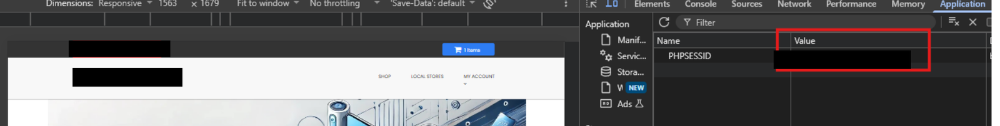

:::note[Sanitized evidence]
Screenshots have the victim email, the session value, the shop brand and the host blacked out with solid boxes. HTTP snippets are transcribed with placeholders like `<SESSION_ID>` and `<VICTIM_EMAIL>`.
:::

## Finding 2: Session hijacking via cookie replay (Critical, 9.1)

`CVSS:3.1/AV:N/AC:L/PR:N/UI:N/S:U/C:H/I:H/A:N`

This is the deep dive. The question from recon was simple: when a user logs out, does the server actually end the session, or does it just tell the browser to forget the cookie? If it's the latter, a copied cookie keeps working forever.

### The test

1. **Log in as the victim** in browser A and read the `PHPSESSID` value from the browser's cookie store.

   ```http
   Cookie: PHPSESSID=<SESSION_ID>
   ```

2. **Log out** in browser A. The app clears the cookie client-side and returns me to the guest view.

3. **Open browser B** (a different browser profile, no login). It shows `Welcome: Guest`. Using a cookie editor, I set the same value captured in step 1:

   ```http
   Cookie: PHPSESSID=<SESSION_ID>
   ```

4. **Reload.** Browser B is now logged in as the victim, with no email or password entered, **after** the victim logged out.



The `MY ACCOUNT` menu and the populated cart confirm an authenticated session. The cookie value is the one captured before logout.

### Why it matters

The session ID is never invalidated server-side. Logout is cosmetic: it removes the cookie from the browser but leaves the session valid on the server. Consequences:

- A stolen cookie (via the [XSS](/blog/broken-auth-and-access-control/post-exploitation) or [cleartext transport](/blog/broken-auth-and-access-control/post-exploitation) findings) grants full account access.
- **The victim cannot defend themselves by logging out.** The usual advice fails here.
- There is no automatic expiry, so the window never closes on its own.

The likelihood is rated moderate (the attacker must first obtain a cookie), but once obtained the exploitation is trivial, and this app offers two separate ways to obtain one.

## Finding 10: Account takeover via insecure password reset (Critical, 9.1)

`CVSS:3.1/AV:N/AC:L/PR:N/UI:N/S:U/C:H/I:H/A:N`

The "forgot password" flow posts only an email address:

```http
POST /functions/fetch_password.php HTTP/1.1
Host: shoplab.lab

email=<VICTIM_EMAIL>
```

Intercepting the response showed the backend generate a new 8-character password, update it in the database, and hand it back through a third-party email API, in cleartext, in the request body (`template_params.password`). There is no ownership check and no one-time confirmation link sent to the real account owner.

**Impact:** anyone who knows a customer's email address can reset that account's password and immediately learn the new value, a full account takeover with only public information. This needs no cookie and no session; it is the single cheapest takeover path in the whole engagement.

## Finding 7: IDOR in `confirm.php` — other customers' orders (High, 8.1)

`CVSS:3.1/AV:N/AC:L/PR:L/UI:N/S:U/C:H/I:H/A:N`

Order confirmation is reached by an integer ID with no ownership check:

```http
GET /customer/confirm.php?order_id=<id>
```

Logged in as one customer, I changed `order_id` from my own order to another customer's. The page loaded that order and let me view it and confirm its payment status. Because the IDs are sequential, I verified the pattern across the range in use at test time (roughly `order_id` 1–130) with Burp Intruder, reading and acting on orders that were not mine.

**Impact:** any authenticated customer can read every customer's order data, and change payment status on orders they don't own. This exposes PII and transaction records and corrupts order integrity, without any takeover.

## Finding 3: Parameter tampering on checkout price (Moderate, 6.5)

`CVSS:3.1/AV:N/AC:L/PR:L/UI:N/S:U/C:N/I:H/A:N`

The add-to-cart request sends the product price from the client:

```http
POST /<product-slug> HTTP/1.1
Host: shoplab.lab

product_qty=1&product_price=<client-supplied>&add_cart=...
```

I intercepted the request in Burp Suite and changed `product_price` from a product's real catalog price to a token amount, then completed checkout. The order finished with status **Paid** at the tampered price, which proves the price is never re-validated against the database at any stage (cart → checkout → payment).

**Impact:** direct financial loss. A buyer can set any price for any product and the server accepts it.

## Where this leaves me

I can take over accounts two ways (replay a never-expiring session, or reset any password from an email), read and act on other customers' orders, and buy at arbitrary prices. The next page shows how the remaining findings, stored XSS, plaintext storage and missing HTTPS, feed the session-theft path and make every leaked password immediately usable.

Next: [Post-Exploitation & Privilege Escalation](/blog/broken-auth-and-access-control/post-exploitation)
