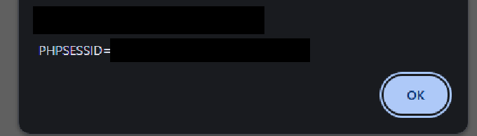

The exploitation page covered the direct account-takeover paths. This page covers the three findings whose damage comes from how they combine: stored XSS, plaintext password storage, and missing transport security. On their own each is a familiar bug. Together with [Finding 2 (session never expires)](/blog/broken-auth-and-access-control/exploitation) they turn a single stolen cookie into a durable account takeover.

## Finding 4: Stored XSS in the profile name (High, 7.6)

`CVSS:3.1/AV:N/AC:L/PR:L/UI:R/S:C/C:H/I:L/A:N`

The profile edit form (`POST /customer/my_account.php?edit_account`) does not encode the `c_name` field on output. I saved a proof payload in the name field:

```html
<script>alert(document.cookie)</script>
```

When the profile page was reloaded, the script executed and the alert showed the page's cookies, including the session cookie:



:::caution[Why `document.cookie` is the point]
The payload uses `alert(document.cookie)` as a non-destructive proof. It matters because recon found the session cookie has **no `HttpOnly` flag**. A real attacker would replace the alert with a one-liner that sends `document.cookie` to a server they control, stealing the session of anyone who views the page, which for a name field shown in the admin customer list could include an administrator.
:::

The same missing-encoding pattern appeared on several admin fields (`edit_product_title`, `manufacturer_name`, `cat_title`, `admin_name`), so the issue is systemic output handling, not one field.

## Finding 6: Plaintext password storage (High, 7.5)

`CVSS:3.1/AV:N/AC:L/PR:N/UI:N/S:U/C:H/I:N/A:N`

The database dump from the [first case study](/blog/recon-to-admin-takeover/exploitation) showed the `customers` table (like `admins`) storing passwords as cleartext, not hashes, no sign of bcrypt/argon2 or any salt:

```text
admin_pass / customer password column:  <plaintext>, e.g. no "$2y$..." hash prefix
```

This is a separate root cause from the injection that exposed it: injection is an input-validation failure, this is a data-at-rest failure. Its effect is a multiplier. Every password reachable through **any** leak path, the exposed `.git` backup, the SQL injection, is usable immediately, with no cracking, and can be replayed against the victim's accounts on other services (credential stuffing).

## Finding 9: Missing HTTPS — cleartext credentials (Moderate, 6.5)

`CVSS:3.1/AV:A/AC:L/PR:N/UI:N/S:U/C:H/I:N/A:N`

The shop serves only plain HTTP, with no redirect to HTTPS and no certificate. Capturing my own test login on my own test network showed the credentials in the clear inside the `POST /login.php` body:

```http
POST /login.php HTTP/1.1
Host: shoplab.lab

c_email=<VICTIM_EMAIL>&c_pass=<VICTIM_PASSWORD>
```

The attack vector is adjacent (`AV:A`): an attacker on the same network path (public Wi-Fi, shared LAN) can read every login and every session cookie straight off the wire.

## How these chain into takeover

```text
Missing HTTPS (9)         ─┐
                          ├─►  attacker obtains a session cookie
Stored XSS (4)            ─┘     (sniffed on the wire, or read via document.cookie
 + cookie has no HttpOnly         because there is no HttpOnly flag)
                                        │
                                        ▼
            Session never expires (2):  the cookie keeps working,
            and logout does not stop it  ──►  durable account access
                                        │
                                        ▼
            Plaintext storage (6):  any password seen along the way is
            usable right away, here and on the victim's other accounts
```

Two independent ways to grab a cookie, a session that never dies, and passwords stored and sent in the clear. Each finding lowers the cost of the next. An attacker on the same Wi-Fi as a shopper, or one who gets a crafted name rendered in the admin panel, can reach a full, lasting account takeover.

The [Reporting](/blog/broken-auth-and-access-control/reporting) page turns each link into a concrete fix and sets the priority order.

Next: [Reporting & Remediation](/blog/broken-auth-and-access-control/reporting)
