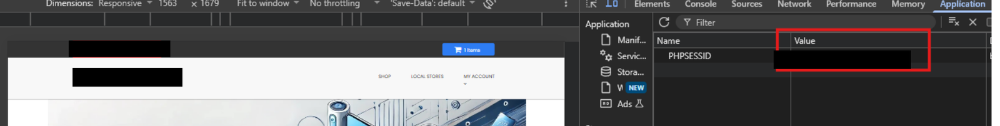
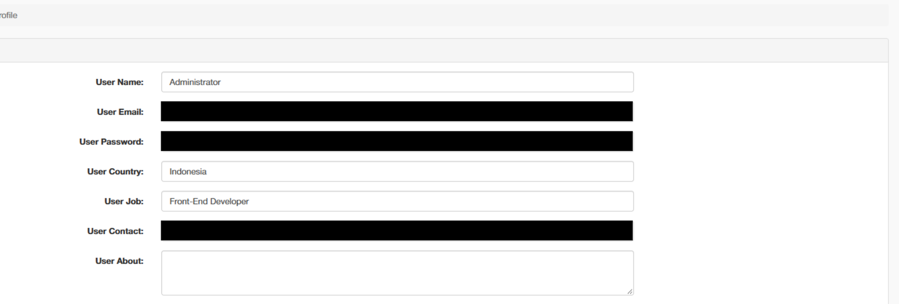
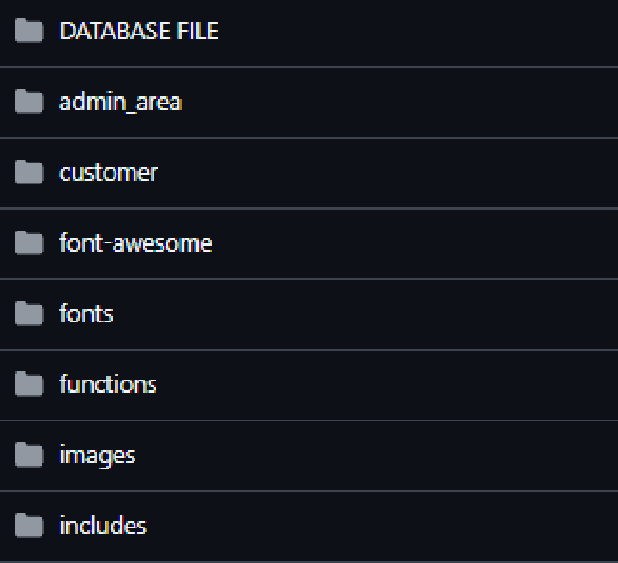

The 10 findings below are ordered by severity (Critical → Moderate), matching the report card. Each lists its category, CVSS 3.1 vector, affected endpoint, a technical description, its business impact in plain language, evidence and remediation. The original report numbers findings differently (by section); that number is noted as "report ref." for traceability.

:::note[Sanitized evidence]
Screenshots black out credentials, emails, session (`PHPSESSID`) values and contact numbers with solid boxes (not reversible blur), and the images have their metadata stripped. In HTTP and tool output, credentials, session values and personal data are redacted as `<SESSION_ID>`, `<VICTIM_EMAIL>` and `<REDACTED>`. The target's own identifiers (name, host `bimbycart.duckdns.org`, IP) are shown as-is, since it is an authorized Dibimbing lab.
:::

---

## 1. Improper session expiration — session hijacking via cookie replay

- **Severity:** Critical (9.1) · `CVSS:3.1/AV:N/AC:L/PR:N/UI:N/S:U/C:H/I:H/A:N`
- **Category:** Broken authentication / session management · **Report ref.:** Finding 2
- **Endpoint:** `PHPSESSID` session cookie · **Tools:** browser cookie editor, manual testing

**Description.** A stolen session cookie hands an attacker the victim's entire account — and doesn't give it back when the victim logs out. I copied a logged-in user's `PHPSESSID`, had that user log out, then set the cookie in a fresh browser with no login of its own: I landed fully authenticated as the victim, with no email or password. The cause sits server-side — logout clears only the browser cookie while the session record lives on, so the ID never expires and can be replayed at will.

**Business impact.** Logging out doesn't actually lock the door. Anyone who gets hold of a customer's active session — a shared or public computer, a sniffed connection — can keep using that account afterwards, so "I logged out" gives customers a false sense of safety and leaves the business carrying the fallout from hijacked accounts.

**Evidence.**



The `MY ACCOUNT` menu and populated cart confirm an authenticated session, using the cookie captured before logout.

**Remediation.**

- Invalidate the session server-side on every logout (destroy the session record, not just the client cookie).
- Add idle and absolute session timeouts.
- Regenerate the session ID on every privilege change (login, logout, password change).
- Set `HttpOnly`, `Secure` and `SameSite` on the session cookie.

---

## 2. SQL injection in the coupon `code` parameter — full database compromise

- **Severity:** Critical (9.8) · `CVSS:3.1/AV:N/AC:L/PR:N/UI:N/S:U/C:H/I:H/A:H`
- **Category:** Injection · **Report ref.:** Finding 5
- **Endpoint:** `POST /cart.php`, parameter `code` · **Tools:** Burp Suite, sqlmap

**Description.** One unauthenticated input — the coupon box — gives up the entire database and, with it, the admin panel. The `code` field is concatenated straight into a SQL query with no parameterization, so it is injectable; sqlmap confirmed boolean-based, error-based and time-based blind. From there I enumerated every database, mapped the 16 tables of the shop schema, dumped the `admins` table — passwords in plaintext — and signed into `/admin_area/` with them on the first try. No account is needed to begin, and the end state is a full database read plus admin takeover.

**Business impact.** A stranger on the internet can copy the entire customer and order database and walk into the admin dashboard — no password, no insider. The whole business becomes readable and controllable from the outside. This is the single most damaging finding: it exposes every customer's personal data at once and is the kind of breach that destroys customer trust and invites regulatory and legal consequences.

**Evidence.** The captured request was saved and replayed with sqlmap:

```http title="cart-request.txt (sanitized)"
POST /cart.php HTTP/1.1
Host: bimbycart.duckdns.org
Content-Type: application/x-www-form-urlencoded
Cookie: PHPSESSID=<SESSION_ID>

quantity-3=1&code=123&apply_coupon=Apply+Coupon+Code
```

```text title="sqlmap (excerpt)"
Parameter: code (POST)
    Type: boolean-based blind
    Type: error-based
    Type: time-based blind
[INFO] the back-end DBMS is MySQL
available databases [3]:
[*] information_schema
[*] performance_schema
[*] dibimbing-shop

Database: dibimbing-shop  [16 tables]   (incl. admins, customers, payments, ...)
```

Dumping only the `admins` table (to prove impact without touching customer data) returned the administrator email and a **plaintext** password, which logged into `/admin_area/login.php` on the first attempt.

**Remediation.**

- Use parameterized queries / prepared statements for every query involving user input.
- Validate and whitelist the `code` parameter server-side.
- Apply least privilege to the application's database account.
- Disable detailed database errors in production; consider a WAF as an extra layer.
- Rotate all exposed admin credentials.

---

## 3. IDOR in admin `user_profile` — admin-to-admin takeover & password disclosure

- **Severity:** Critical (9.6) · `CVSS:3.1/AV:N/AC:L/PR:L/UI:N/S:C/C:H/I:H/A:N`
- **Category:** Broken access control / IDOR · **Report ref.:** Finding 8
- **Endpoint:** `GET /admin_area/index.php?user_profile=<id>`, parameter `user_profile` · **Tools:** manual testing

**Description.** Any one admin can read and overwrite every other admin's account, plaintext password included. Logged in as a single admin (via Finding 2), I changed `user_profile` to another admin's sequential ID and the backend served that admin's edit form — not just to view but to modify, because there is no object-level authorization check behind the ID. The form even returns the stored password in **plaintext** (CWE-256), so one compromised admin escalates to control of the entire admin tier.

**Business impact.** There is no wall between your own administrators. Any staff account with admin access can quietly seize control of every other admin — the owner's included — and read their passwords. A single disgruntled or compromised employee can take over the whole back office.

**Evidence.**




**Remediation.**

- Enforce object-level authorization on every endpoint that takes an ID.
- Use indirect references (per-user UUID/token) for sensitive records instead of sequential IDs.
- Add real role separation (RBAC) between admin levels.
- Never return the password field (plaintext or hash) in an edit form; leave it empty and only update on change.

---

## 4. Account takeover via insecure password reset

- **Severity:** Critical (9.1) · `CVSS:3.1/AV:N/AC:L/PR:N/UI:N/S:U/C:H/I:H/A:N`
- **Category:** Broken authentication / insecure recovery · **Report ref.:** Finding 10
- **Endpoint:** `POST /functions/fetch_password.php`, parameter `email` · **Tools:** Burp Suite

**Description.** Anyone who knows a customer's email can take over that account outright. The "forgot password" flow asks for an email and nothing else — no ownership check. The backend generates a new 8-character password, writes it to the database, and hands it back in cleartext through a third-party email API in the request body (`template_params.password`), with no confirmation link or token ever sent to the real owner. Submit the victim's email, read the response, log in.

**Business impact.** A customer's email address — something they share freely — is all it takes to hijack their account. Anyone could take over any customer, including high-value ones, without stealing a single password. It makes every account on the platform only as safe as a publicly known email.

**Evidence.**

```http title="Reset request (sanitized)"
POST /functions/fetch_password.php HTTP/1.1
Host: bimbycart.duckdns.org

email=<VICTIM_EMAIL>
```

Intercepting the resulting traffic showed the backend call the email API with the freshly generated password in cleartext in `template_params.password`. The source file `functions/fetch_password.php` confirmed the endpoint updates and returns the password with no validation.

**Remediation.**

- Use a single-use, time-limited reset token emailed to the registered address; never return a new password in the response.
- Keep the response identical whether or not the email exists (no account enumeration).
- Rate-limit the endpoint, invalidate active sessions on reset, and notify the owner.

---

## 5. Information disclosure — exposed `.git` repository

- **Severity:** High (7.5) · `CVSS:3.1/AV:N/AC:L/PR:N/UI:N/S:U/C:H/I:N/A:N`
- **Category:** Information disclosure · **Report ref.:** Finding 1
- **Endpoint:** `/.git` · **Tools:** Nmap

**Description.** The full application source and a complete database backup — every credential and all customer PII — are downloadable without exploiting anything. The `/.git` directory is publicly readable (surfaced by Nmap's `http-git` script during recon), and its config points to a **public** GitHub repository with the entire source. Committed next to the code is a database backup holding the schema and full contents, passwords in plaintext. Reading it takes a browser, not an attack.

**Business impact.** A full copy of the website's code and a backup of the customer database are sitting in the open, free for anyone to download — no hacking required. Every customer's personal data and every password is effectively already out the door, and once copied it can never be recalled.

**Evidence.**



The `DATABASE FILE` folder held a full SQL dump; the admin row stored the password as cleartext (`<REDACTED_PLAINTEXT_PASSWORD>`), not a hash.

**Remediation.**

- Block `/.git` at the web server (`RedirectMatch 404 /\.git` for Apache; `location ~ /\.git { deny all; }` for nginx).
- Never commit backups, `.env` files or credentials; use `.gitignore`.
- Take down / privatize the public repo and purge history; treat all exposed secrets as burned and rotate them.

---

## 6. Stored XSS in the profile name field

- **Severity:** High (7.6) · `CVSS:3.1/AV:N/AC:L/PR:L/UI:R/S:C/C:H/I:L/A:N`
- **Category:** Stored XSS · **Report ref.:** Finding 4
- **Endpoint:** `POST /customer/my_account.php?edit_account`, parameter `c_name` · **Tools:** Burp Suite, manual testing

**Description.** A name crafted by one customer can steal the session of anyone who views it — up to and including an administrator. The profile name field is never encoded on output, so a script saved in it runs when the profile page reloads; and because the session cookie carries no `HttpOnly` flag, that script can read `document.cookie` and exfiltrate the session. Customer names render in the admin panel too, which puts admins in range. The missing-encoding pattern repeats across several admin fields (`edit_product_title`, `manufacturer_name`, `cat_title`, `admin_name`), so this is systemic, not a one-field slip.

**Business impact.** A malicious customer can plant a hidden trap in their own profile that hijacks the account of any employee who opens it in the admin panel — turning one ordinary customer into a doorway into your back office, without any staff member doing anything wrong.

**Evidence.** Proof payload saved in the name field:

```html
<script>alert(document.cookie)</script>
```

On reload the script ran and the alert showed the session cookie:


**Remediation.**

- Output-encode all user data rendered to a page (`htmlspecialchars`), on customer and admin pages.
- Validate input server-side to reject HTML/tags in fields that don't need them.
- Add a Content Security Policy as defense in depth.
- Set `HttpOnly` on the session cookie (links to Finding 1).

---

## 7. IDOR in `confirm.php` — access & confirm other users' orders

- **Severity:** High (8.1) · `CVSS:3.1/AV:N/AC:L/PR:L/UI:N/S:U/C:H/I:H/A:N`
- **Category:** Broken access control / IDOR · **Report ref.:** Finding 7
- **Endpoint:** `GET /customer/confirm.php`, parameter `order_id` · **Tools:** Burp Suite, manual testing

**Description.** Any logged-in customer can read — and confirm the payment status of — every other customer's order. The order-confirmation endpoint never checks that the `order_id` in the URL belongs to the session's customer, so changing that one number walks straight into someone else's order. The IDs are sequential, so the whole range live at test time (roughly `order_id` 1–130) sweeps automatically with Burp Intruder; one customer can enumerate the lot.

**Business impact.** Any logged-in customer can snoop on every other customer's orders — who bought what, for how much — and even mark them as paid. That is a privacy breach and an opening for order fraud, and it means no customer's purchase history is private from any other customer.

**Evidence.**

```http title="Request (sanitized)"
GET /customer/confirm.php?order_id=<other-customers-id> HTTP/1.1
Host: bimbycart.duckdns.org
Cookie: PHPSESSID=<SESSION_ID>
```

Changing `order_id` from my own order to another customer's loaded and let me act on that order; iterating the range confirmed the pattern across ~130 orders.

**Remediation.**

- Verify that the requested `order_id` belongs to the session's customer before reading or processing anything.
- Apply authorization middleware consistently to every endpoint that reads user-owned data (orders, cart, wishlist, history).
- Prefer unpredictable identifiers; add logging and rate limiting to detect sequential-ID sweeps.

---

## 8. Insecure password storage (plaintext)

- **Severity:** High (7.5) · `CVSS:3.1/AV:N/AC:L/PR:N/UI:N/S:U/C:H/I:N/A:N`
- **Category:** Cryptographic failure / insecure storage · **Report ref.:** Finding 6
- **Endpoint:** `customers` table (observed via the Finding 2 dump) · **Tools:** Burp Suite, sqlmap

**Description.** Every password that leaks by any path is usable the instant it is seen — and reusable against the victim's other accounts. The database dump showed the `customers` table, like `admins`, storing passwords as cleartext: no salt, no hash, no `$2y$...` bcrypt prefix. This is a distinct root cause from the injection that exposed it — that was an input-validation failure, this is a data-at-rest failure — and it acts as a multiplier on every other leak (the `.git` backup, the SQL injection), turning each one into immediate credential stuffing.

**Business impact.** Passwords are kept as plain readable text instead of being scrambled. The moment any copy leaks, every customer and admin password works instantly — and because people reuse passwords, the harm spreads to their email, banking and other services. That turns a website breach into a problem that follows your customers everywhere and lands back on your reputation.

**Evidence.**

```text
customer / admin password column:  stored as <plaintext>, no hash prefix (e.g. no "$2y$...")
```

**Remediation.**

- Hash all passwords with a slow algorithm (argon2id or bcrypt) and a unique per-user salt.
- Force a password reset for every existing account after migrating (the stored plaintext is already exposed).
- Enforce a minimum password policy on registration and change.

---

## 9. Parameter tampering on add-to-cart / checkout price

- **Severity:** Moderate (6.5) · `CVSS:3.1/AV:N/AC:L/PR:L/UI:N/S:U/C:N/I:H/A:N`
- **Category:** Business logic · **Report ref.:** Finding 3
- **Endpoint:** `POST /<product-slug>`, parameter `product_price` · **Tools:** Burp Suite

**Description.** A shopper can set their own price and check out at it. The add-to-cart request carries the product price from the client, and the server takes it on trust, never re-reading the catalog price from the database. In Burp Suite I changed `product_price` from a product's real price to a token amount and completed checkout: the order closed with status **Paid** at the price I chose. Nothing in the flow — cart, checkout, or payment — re-validates the figure.

**Business impact.** Customers can set their own price at checkout and still receive an order marked Paid. That is direct, repeatable revenue loss — goods shipped for a fraction of their value — and once the trick is known it can be used at scale.

**Evidence.**

```http title="Tampered request (sanitized)"
POST /<product-slug> HTTP/1.1
Host: bimbycart.duckdns.org

product_qty=1&product_price=<client-supplied>&add_cart=...
```

The order completed with status `Paid` at the attacker-chosen price.

**Remediation.**

- Always re-read the price from the database by `product_id` on the server; ignore any client-supplied price.
- Re-validate totals at every stage: add-to-cart, checkout, and payment confirmation.
- Alert on orders whose totals fall outside a product's normal range.

---

## 10. Missing HTTPS — cleartext transmission of credentials

- **Severity:** Moderate (6.5) · `CVSS:3.1/AV:A/AC:L/PR:N/UI:N/S:U/C:H/I:N/A:N`
- **Category:** Cryptographic failure / insecure transport · **Report ref.:** Finding 9
- **Endpoint:** all application endpoints · **Tools:** Wireshark

**Description.** Anyone on the same network path can read every login, session cookie and transaction in the clear. The shop serves plain HTTP only — no certificate, no redirect to HTTPS — so all traffic crosses the wire unencrypted and open to a man-in-the-middle. Capturing my own test login on my own test network showed the `POST /login.php` body with the credentials fully readable.

**Business impact.** The site has no padlock. On any shared Wi-Fi, a customer's login and personal details can be read by a stranger sitting nearby, and modern browsers visibly flag the site as "Not secure" — which quietly turns buyers away before they ever reach checkout.

**Evidence.**

```http title="Captured login (sanitized)"
POST /login.php HTTP/1.1
Host: bimbycart.duckdns.org

c_email=<VICTIM_EMAIL>&c_pass=<VICTIM_PASSWORD>
```

The vector is adjacent (`AV:A`): an attacker on the same network (public Wi-Fi, shared LAN) can sniff every login and session cookie, which also feeds the session-hijacking finding.

**Remediation.**

- Install a valid TLS certificate (e.g. Let's Encrypt) and redirect all HTTP to HTTPS (301).
- Mark session cookies `Secure`.
- Add HSTS to prevent downgrade / SSL-stripping; check for mixed content once HTTPS is on.

---

Next: [Conclusion](/blog/dibimbing-shop-web-pentest/conclusion)
