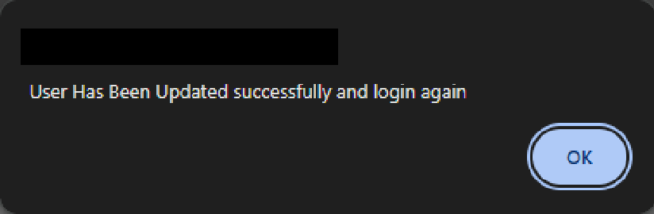
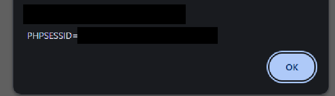

The 10 findings below are ordered by severity (Critical → Moderate), matching the report card. Each lists its category, CVSS 3.1 vector, affected endpoint, description, evidence and remediation. The original report numbers findings differently (by section); that number is noted as "report ref." for traceability.

:::note[Sanitized evidence]
Screenshots black out credentials, emails, session (`PHPSESSID`) values and contact numbers with solid boxes (not reversible blur), and the images have their metadata stripped. In HTTP and tool output, credentials, session values and personal data are redacted as `<SESSION_ID>`, `<VICTIM_EMAIL>` and `<REDACTED>`. The target's own identifiers (name, host `bimbycart.duckdns.org`, IP) are shown as-is, since it is an authorized Dibimbing lab.
:::

---

## 1. Improper session expiration — session hijacking via cookie replay

- **Severity:** Critical (9.1) · `CVSS:3.1/AV:N/AC:L/PR:N/UI:N/S:U/C:H/I:H/A:N`
- **Category:** Broken authentication / session management · **Report ref.:** Finding 2
- **Endpoint:** `PHPSESSID` session cookie · **Tools:** browser cookie editor, manual testing

**Description.** The application does not invalidate the session server-side on logout. I captured a logged-in user's `PHPSESSID`, logged that browser out, then set the same cookie in a different browser with no login — and was fully authenticated as the victim, without any email or password. The session ID is never destroyed or expired on the server, so a "logged-out" cookie can still be replayed.

**Evidence.**


The `MY ACCOUNT` menu and populated cart confirm an authenticated session, using the cookie captured before logout.

**Remediation.**

- Invalidate the session server-side on every logout (destroy the session record, not just the client cookie).
- Add idle and absolute session timeouts.
- Regenerate the session ID on every privilege change (login, logout, password change).
- Set `HttpOnly`, `Secure` and `SameSite` on the session cookie.

---

## 2. SQL injection in the coupon `code` parameter — full database compromise

- **Severity:** Critical (9.8) · `CVSS:3.1/AV:N/AC:L/PR:N/UI:N/S:U/C:H/I:H/A:H`
- **Category:** Injection · **Report ref.:** Finding 5
- **Endpoint:** `POST /cart.php`, parameter `code` · **Tools:** Burp Suite, sqlmap

**Description.** The coupon `code` field is concatenated into a SQL query without parameterization, making it injectable (boolean-based, error-based and time-based blind, all confirmed with sqlmap). Through it, an unauthenticated attacker enumerated all databases and the 16 tables of the shop database, dumped the `admins` table (passwords in plaintext), and used those credentials to log straight into the admin panel — a full database read plus admin account takeover.

**Evidence.** The captured request was saved and replayed with sqlmap:

```http title="cart-request.txt (sanitized)"
POST /cart.php HTTP/1.1
Host: bimbycart.duckdns.org
Content-Type: application/x-www-form-urlencoded
Cookie: PHPSESSID=<SESSION_ID>

quantity-3=1&code=123&apply_coupon=Apply+Coupon+Code
```

```text title="sqlmap (excerpt)"
Parameter: code (POST)
    Type: boolean-based blind
    Type: error-based
    Type: time-based blind
[INFO] the back-end DBMS is MySQL
available databases [3]:
[*] information_schema
[*] performance_schema
[*] dibimbing-shop

Database: dibimbing-shop  [16 tables]   (incl. admins, customers, payments, ...)
```

Dumping only the `admins` table (to prove impact without touching customer data) returned the administrator email and a **plaintext** password, which logged into `/admin_area/login.php` on the first attempt.

**Remediation.**

- Use parameterized queries / prepared statements for every query involving user input.
- Validate and whitelist the `code` parameter server-side.
- Apply least privilege to the application's database account.
- Disable detailed database errors in production; consider a WAF as an extra layer.
- Rotate all exposed admin credentials.

---

## 3. IDOR in admin `user_profile` — admin-to-admin takeover & password disclosure

- **Severity:** Critical (9.6) · `CVSS:3.1/AV:N/AC:L/PR:L/UI:N/S:C/C:H/I:H/A:N`
- **Category:** Broken access control / IDOR · **Report ref.:** Finding 8
- **Endpoint:** `GET /admin_area/index.php?user_profile=<id>`, parameter `user_profile` · **Tools:** manual testing

**Description.** The admin profile endpoint selects an admin by a sequential integer ID with no object-level authorization check. Logged in as one admin (via Finding 2), I changed `user_profile` to another admin's ID and reached that admin's edit form — and could not only read it but modify it. The form also returns the stored password in **plaintext** (CWE-256), so any admin can read and overwrite any other admin's account.

**Evidence.**




**Remediation.**

- Enforce object-level authorization on every endpoint that takes an ID.
- Use indirect references (per-user UUID/token) for sensitive records instead of sequential IDs.
- Add real role separation (RBAC) between admin levels.
- Never return the password field (plaintext or hash) in an edit form; leave it empty and only update on change.

---

## 4. Account takeover via insecure password reset

- **Severity:** Critical (9.1) · `CVSS:3.1/AV:N/AC:L/PR:N/UI:N/S:U/C:H/I:H/A:N`
- **Category:** Broken authentication / insecure recovery · **Report ref.:** Finding 10
- **Endpoint:** `POST /functions/fetch_password.php`, parameter `email` · **Tools:** Burp Suite

**Description.** The "forgot password" flow takes only an email address and performs no ownership verification. The backend generates a new 8-character password, updates it in the database, and returns it in cleartext through a third-party email API in the request body (`template_params.password`) — with no confirmation link or token sent to the real owner. Anyone who knows a customer's email can reset that account and immediately learn the new password.

**Evidence.**

```http title="Reset request (sanitized)"
POST /functions/fetch_password.php HTTP/1.1
Host: bimbycart.duckdns.org

email=<VICTIM_EMAIL>
```

Intercepting the resulting traffic showed the backend call the email API with the freshly generated password in cleartext in `template_params.password`. The source file `functions/fetch_password.php` confirmed the endpoint updates and returns the password with no validation.

**Remediation.**

- Use a single-use, time-limited reset token emailed to the registered address; never return a new password in the response.
- Keep the response identical whether or not the email exists (no account enumeration).
- Rate-limit the endpoint, invalidate active sessions on reset, and notify the owner.

---

## 5. Information disclosure — exposed `.git` repository

- **Severity:** High (7.5) · `CVSS:3.1/AV:N/AC:L/PR:N/UI:N/S:U/C:H/I:N/A:N`
- **Category:** Information disclosure · **Report ref.:** Finding 1
- **Endpoint:** `/.git` · **Tools:** Nmap

**Description.** The `/.git` directory is publicly readable (found via Nmap's `http-git` script during recon). Its config pointed to a **public** GitHub repository holding the full application source. Committed alongside the code was a database backup containing the schema and full contents — admin credentials and all customer PII — with passwords in plaintext. No exploitation is needed to obtain any of this.

**Evidence.**


The `DATABASE FILE` folder held a full SQL dump; the admin row stored the password as cleartext (`<REDACTED_PLAINTEXT_PASSWORD>`), not a hash.

**Remediation.**

- Block `/.git` at the web server (`RedirectMatch 404 /\.git` for Apache; `location ~ /\.git { deny all; }` for nginx).
- Never commit backups, `.env` files or credentials; use `.gitignore`.
- Take down / privatize the public repo and purge history; treat all exposed secrets as burned and rotate them.

---

## 6. Stored XSS in the profile name field

- **Severity:** High (7.6) · `CVSS:3.1/AV:N/AC:L/PR:L/UI:R/S:C/C:H/I:L/A:N`
- **Category:** Stored XSS · **Report ref.:** Finding 4
- **Endpoint:** `POST /customer/my_account.php?edit_account`, parameter `c_name` · **Tools:** Burp Suite, manual testing

**Description.** The profile name field is not encoded on output. A payload saved in the name executes when the profile page is reloaded. Because the session cookie has no `HttpOnly` flag, the script can read `document.cookie`, which makes this practically usable to steal the session of anyone who views the name — including an administrator, since customer names render in the admin panel. The same missing-encoding pattern appears on several admin fields (`edit_product_title`, `manufacturer_name`, `cat_title`, `admin_name`), so it is systemic.

**Evidence.** Proof payload saved in the name field:

```html
<script>alert(document.cookie)</script>
```

On reload the script ran and the alert showed the session cookie:



**Remediation.**

- Output-encode all user data rendered to a page (`htmlspecialchars`), on customer and admin pages.
- Validate input server-side to reject HTML/tags in fields that don't need them.
- Add a Content Security Policy as defense in depth.
- Set `HttpOnly` on the session cookie (links to Finding 1).

---

## 7. IDOR in `confirm.php` — access & confirm other users' orders

- **Severity:** High (8.1) · `CVSS:3.1/AV:N/AC:L/PR:L/UI:N/S:U/C:H/I:H/A:N`
- **Category:** Broken access control / IDOR · **Report ref.:** Finding 7
- **Endpoint:** `GET /customer/confirm.php`, parameter `order_id` · **Tools:** Burp Suite, manual testing

**Description.** The order-confirmation endpoint does not verify that the requested `order_id` belongs to the logged-in customer. Any authenticated customer can change `order_id` in the URL to view, and even confirm the payment status of, another customer's order. Because the IDs are sequential, the whole range in use at test time (roughly `order_id` 1–130) can be swept automatically with Burp Intruder.

**Evidence.**

```http title="Request (sanitized)"
GET /customer/confirm.php?order_id=<other-customers-id> HTTP/1.1
Host: bimbycart.duckdns.org
Cookie: PHPSESSID=<SESSION_ID>
```

Changing `order_id` from my own order to another customer's loaded and let me act on that order; iterating the range confirmed the pattern across ~130 orders.

**Remediation.**

- Verify that the requested `order_id` belongs to the session's customer before reading or processing anything.
- Apply authorization middleware consistently to every endpoint that reads user-owned data (orders, cart, wishlist, history).
- Prefer unpredictable identifiers; add logging and rate limiting to detect sequential-ID sweeps.

---

## 8. Insecure password storage (plaintext)

- **Severity:** High (7.5) · `CVSS:3.1/AV:N/AC:L/PR:N/UI:N/S:U/C:H/I:N/A:N`
- **Category:** Cryptographic failure / insecure storage · **Report ref.:** Finding 6
- **Endpoint:** `customers` table (observed via the Finding 2 dump) · **Tools:** Burp Suite, sqlmap

**Description.** The database dump showed the `customers` table (like `admins`) storing passwords as cleartext, with no hashing or salting (no `$2y$...` bcrypt prefix or any hash). This is a separate root cause from the injection that exposed it: injection is an input-validation failure, this is a data-at-rest failure. Its effect is a multiplier — every password reachable through any leak path (the `.git` backup, the SQL injection) is usable immediately, and reusable against the victim's accounts elsewhere (credential stuffing).

**Evidence.**

```text
customer / admin password column:  stored as <plaintext>, no hash prefix (e.g. no "$2y$...")
```

**Remediation.**

- Hash all passwords with a slow algorithm (argon2id or bcrypt) and a unique per-user salt.
- Force a password reset for every existing account after migrating (the stored plaintext is already exposed).
- Enforce a minimum password policy on registration and change.

---

## 9. Parameter tampering on add-to-cart / checkout price

- **Severity:** Moderate (6.5) · `CVSS:3.1/AV:N/AC:L/PR:L/UI:N/S:U/C:N/I:H/A:N`
- **Category:** Business logic · **Report ref.:** Finding 3
- **Endpoint:** `POST /<product-slug>`, parameter `product_price` · **Tools:** Burp Suite

**Description.** The add-to-cart request sends the product price from the client, and the server accepts it without re-checking against the catalog price in the database. I intercepted the request in Burp Suite, changed `product_price` from a product's real price to a token amount, and completed checkout — the order finished with status **Paid** at the tampered price, proving there is no server-side price re-validation anywhere in the flow (cart → checkout → payment).

**Evidence.**

```http title="Tampered request (sanitized)"
POST /<product-slug> HTTP/1.1
Host: bimbycart.duckdns.org

product_qty=1&product_price=<client-supplied>&add_cart=...
```

The order completed with status `Paid` at the attacker-chosen price.

**Remediation.**

- Always re-read the price from the database by `product_id` on the server; ignore any client-supplied price.
- Re-validate totals at every stage: add-to-cart, checkout, and payment confirmation.
- Alert on orders whose totals fall outside a product's normal range.

---

## 10. Missing HTTPS — cleartext transmission of credentials

- **Severity:** Moderate (6.5) · `CVSS:3.1/AV:A/AC:L/PR:N/UI:N/S:U/C:H/I:N/A:N`
- **Category:** Cryptographic failure / insecure transport · **Report ref.:** Finding 9
- **Endpoint:** all application endpoints · **Tools:** Wireshark

**Description.** The shop serves only plain HTTP — no redirect to HTTPS, no certificate. All traffic, including login credentials, session cookies and transaction data, travels in cleartext and can be read by anyone on the same network path (a man-in-the-middle). Capturing my own test login on my own test network showed the `POST /login.php` body with the credentials in the clear.

**Evidence.**

```http title="Captured login (sanitized)"
POST /login.php HTTP/1.1
Host: bimbycart.duckdns.org

c_email=<VICTIM_EMAIL>&c_pass=<VICTIM_PASSWORD>
```

The vector is adjacent (`AV:A`): an attacker on the same network (public Wi-Fi, shared LAN) can sniff every login and session cookie, which also feeds the session-hijacking finding.

**Remediation.**

- Install a valid TLS certificate (e.g. Let's Encrypt) and redirect all HTTP to HTTPS (301).
- Mark session cookies `Secure`.
- Add HSTS to prevent downgrade / SSL-stripping; check for mixed content once HTTPS is on.

---

Next: [Conclusion](/blog/dibimbing-shop-web-pentest/conclusion)
