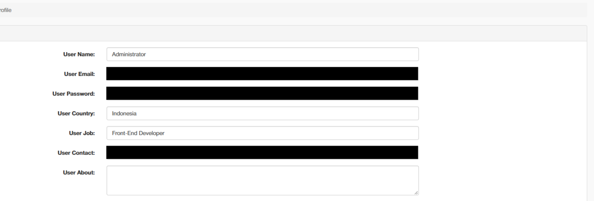
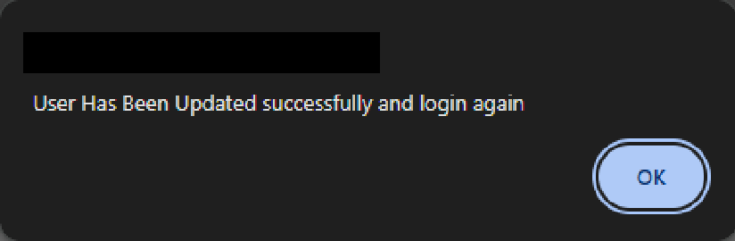

At this point I had one administrator session (from [Finding 5](/blog/recon-to-admin-takeover/exploitation)). In a web application, holding one admin account is the equivalent of a shell as one user; the privilege-escalation question is whether I can move from that account to control over the others. On ShopLab the answer was yes, through a broken access-control check in the admin panel.

:::note[Sanitized evidence]
The screenshots below are from the live admin panel with user email, password and contact fields blacked out. The password field matters: the form returned the stored password in cleartext.
:::

## Finding 8: IDOR in `user_profile` — admin-to-admin takeover (Critical, 9.6)

`CVSS:3.1/AV:N/AC:L/PR:L/UI:N/S:C/C:H/I:H/A:N`

### The weakness

The admin panel edits a profile through:

```text
GET /admin_area/index.php?user_profile=<id>
```

`<id>` is a small sequential integer. The page loads whatever admin matches that ID, and it never checks that the logged-in admin is allowed to see or change that particular account. That is an Insecure Direct Object Reference (IDOR): the object (an admin profile) is selected straight from a user-supplied number, with no ownership or role check.

### Proof of concept

1. **Establish a baseline account.** As the admin from Finding 5, I created a new admin through the panel. It was assigned `user_profile=12`, so I knew which ID was mine.
2. **Change the ID to someone else's.** I edited the URL to point at another admin's ID (`user_profile=2`, the original Administrator) and loaded the profile page.
3. **Read the other admin's data.** The edit form rendered that admin's account, and the `User Password` field was pre-filled with the stored password in cleartext (CWE-256, Plaintext Storage of a Password), not a hash.



4. **Modify the other admin's data.** Submitting the form saved my changes to that other admin's account, which the application confirmed:



### Privilege context: before and after

| | Before | After |
|---|---|---|
| Accounts I control | my own admin login | **every** admin account, including the primary Administrator |
| Access to others' passwords | none | cleartext, read straight from the edit form |
| What I can change | my own profile | any admin's name, email, contact and password |

Being able to change another admin's password means I can lock them out and own their account outright. Because a lower-privileged admin can act on a higher-privileged one, the CVSS vector carries `PR:L` (some privilege needed) and `S:C` (scope change: the impact crosses from my account to others').

### Two failures stacked

This is one finding but two mistakes reinforcing each other:

- **No object-level authorization.** Any admin ID is reachable by any logged-in admin.
- **Password returned to the client.** The edit form sends the stored password back in the response, so the IDOR doesn't just let me overwrite an account, it discloses the existing credential.

Either failure alone is serious. Together they turn the lowest admin account into a master key.

## The full chain

```text
exposed .git / SQL injection  ──►  admin credentials        (Findings 1, 5)
         │
         ▼
   log in to /admin_area/      ──►  one admin session
         │
         ▼
   user_profile=<id> IDOR      ──►  read + edit every admin  (Finding 8)
                                    password disclosure (CWE-256)
```

Starting as an anonymous visitor, the realistic worst case is control of the entire admin tier of the shop. The [Reporting](/blog/recon-to-admin-takeover/reporting) section turns each link in that chain into a concrete fix.

Next: [Reporting & Remediation](/blog/recon-to-admin-takeover/reporting)
